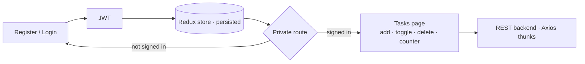

<div align="center">



<p>
  <a href="https://task-planner-eta.vercel.app"></a>
  
  
  
</p>

<p><em>A task planner built to practise modern React: routing, global state,<br>
asynchronous requests and authentication with JSON Web Tokens.</em></p>

</div>


## What it practises

| | |
|---|---|
| **Components** | A component-based layout: app bar, layout, task, form, list and counter. |
| **Routing** | Pages with React Router, including restricted and private routes. |
| **Global state** | Redux Toolkit slices, persisted with redux-persist. |
| **Async** | `createAsyncThunk` with Axios against a REST backend. |
| **Auth** | Register, log in and log out with JWT; only signed-in users reach their tasks. |
| **Forms** | Formik with Yup validation, toast feedback and light motion. |




## Türkçe özet

**Task Planner**, modern React kavramlarını pekiştirmek için yapılmış bir görev planlayıcı: React Router ile sayfa yönetimi, Redux Toolkit ile global durum, `createAsyncThunk` ile backend istekleri ve JWT ile kimlik doğrulama. Korumalı rotalar sayesinde görevlere yalnızca giriş yapmış kullanıcılar ulaşabiliyor. GoIT Full Stack eğitimi sırasında hazırlandı.


## Development

```sh
npm install
npm run dev      # http://localhost:5173
npm run build
```

```
src/components/   AppBar, Layout, Task, TaskForm, TaskList, TaskCounter
src/pages/        Home, Register, Login, Tasks
src/redux/        auth and tasks slices, operations, store
```

<div align="center">
<br>
<a href="https://github.com/kutluhangil"></a>
<sub>A learning project from the GoIT Full Stack programme.</sub>
</div>
