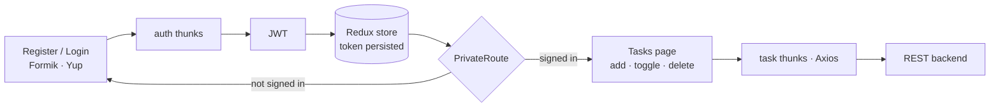

<div align="center">


<p>
  <a href="https://task-planner-eta.vercel.app"></a>
  
  
  
</p>

<p><em>A task planner built to practise modern React: routing, global state,<br>
async requests and JWT authentication, in one small app.</em></p>

</div>


## What it practises

The app is deliberately small so each concept is easy to find: a sign-up and log-in flow that stores a JWT, routes that only open for signed-in users (and others that close once you are signed in), and a task list whose every change goes through an async thunk to a REST backend.

| | |
|---|---|
| **Components** | App bar, user menu, auth navigation, layout, task form, task list and task item. |
| **Routing** | React Router with a `PrivateRoute` for `/tasks` and a `RestrictedRoute` for log-in and sign-up. |
| **Global state** | Redux Toolkit slices for auth and tasks, with selectors; the token is persisted with redux-persist so a refresh keeps you signed in. |
| **Async** | `createAsyncThunk` with Axios: sign up, log in, log out and refresh the current user; fetch, add, toggle and delete tasks. |
| **Auth** | The JWT is set as the Axios `Authorization` header after log-in and cleared on log-out. |
| **Forms** | Formik with Yup validation on log-in and sign-up, toast feedback and light motion. |


## How it fits together



| Thunk | Request |
|---|---|
| `register` · `login` · `logout` · `refreshUser` | `POST /users/signup` · `POST /users/login` · `POST /users/logout` · `GET /users/current` |
| `fetchTasks` · `addTask` · `toggleCompleted` · `deleteTask` | `GET /tasks` · `POST /tasks` · `PATCH /tasks/:id` · `DELETE /tasks/:id` |


## Türkçe özet

**Task Planner**, modern React kavramlarını pekiştirmek için yapılmış bir görev planlayıcı: React Router ile sayfa yönetimi ve korumalı rotalar, Redux Toolkit ile global durum ve redux-persist ile kalıcı oturum (token), `createAsyncThunk` ve Axios ile backend istekleri, JWT ile kimlik doğrulama, Formik ve Yup ile form doğrulama. Görevlere yalnızca giriş yapmış kullanıcılar ulaşabiliyor. GoIT Full Stack eğitimi sırasında hazırlandı.


## Development

```sh
npm install
npm run dev      # http://localhost:5173
npm run build
```

```
src/components/   AppBar, UserMenu, AuthNav, Layout, Task, TaskForm, TaskList, PrivateRoute, RestrictedRoute
src/pages/        Home, Register, Login, Tasks
src/redux/        auth and tasks: slice, operations, selectors · store with redux-persist
```

<div align="center">
<br>
<a href="https://github.com/kutluhangil"></a>
<sub>MIT licensed · a learning project from the GoIT Full Stack programme · tasks in the banner are invented.</sub>
</div>
